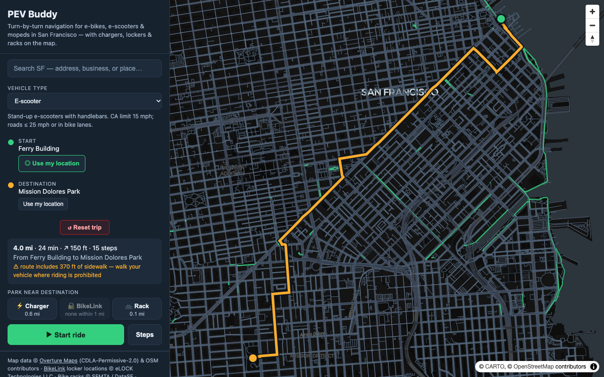
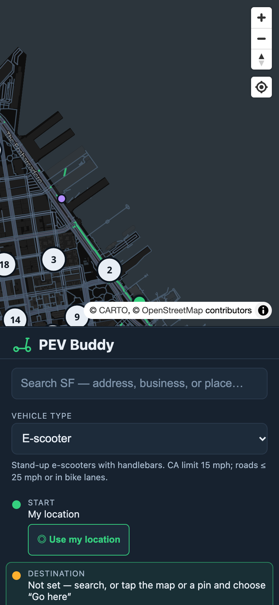
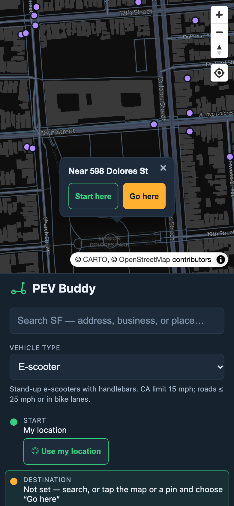
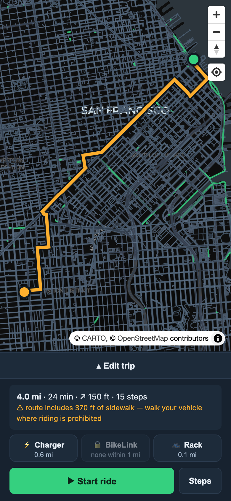
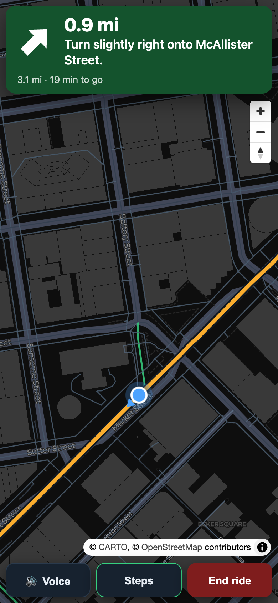
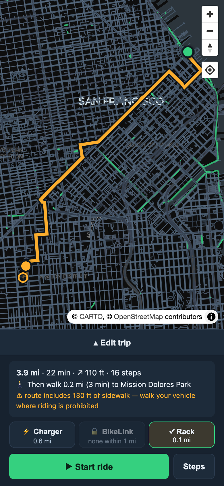
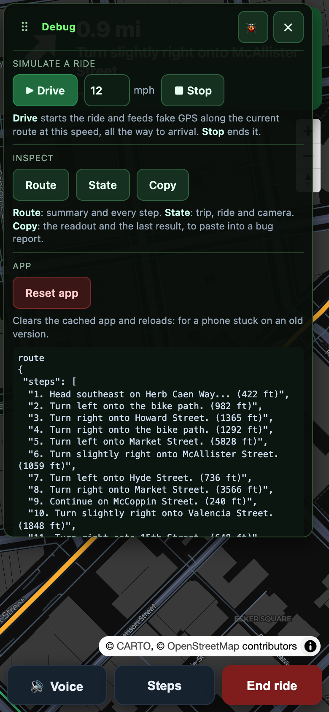

# PEV Buddy

**PEV Buddy is turn-by-turn navigation for e-bikes, e-scooters, boards and
mopeds in San Francisco: from anywhere to anywhere, weighing every street by
its speed, its hills and your vehicle's legal access, and finding you a place
to park or charge when you get there. Built entirely on
[Overture Maps](https://overturemaps.org) and other open data.**

[](https://github.com/imhotep/pev-buddy/actions/workflows/test.yml)

**Live: [pev-buddy.anislab.com](https://pev-buddy.anislab.com)**. Open it in
your phone's browser, or add it to your home screen
([how](#use-it-on-your-phone)). Tap **Start ride** and it guides you
hands-free: a big next-turn banner, voice prompts, and automatic rerouting.



## What it does

- **Routes for your vehicle, by California law.** Pick e-scooter, e-board,
  electric unicycle, Class 1/2/3 e-bike or moped. E-scooters keep to streets
  of 25 mph or less (or bike lanes), boards to streets under 35 mph, mopeds
  follow motor-vehicle rules. Quiet streets and bike lanes are preferred,
  busy ones cost more, freeways are never used.
- **Knows the hills.** Every junction carries its ground elevation. Climbs
  cost extra (most for the small motors of scooters and boards, least for
  mopeds), steep grades and steep descents more again, and uphill stretches
  slow the ETA. The route summary shows the total climb.
- **Parks you near the destination.** Tiles under the route offer the nearest
  EV charger, BikeLink locker and bike rack to where you're going (charger and
  motorcycle parking for mopeds), with distances. Pick one and the route ends
  there, with the walk to your real destination drawn on the map and
  announced on arrival.
- **Rides with you.** Ride mode snaps your GPS to the route, shows the next
  turn with a live countdown, speaks it ("In 500 feet, turn right onto …"),
  reroutes when you leave the route, turns the map to face your direction of
  travel, and keeps the screen on.
- **Feels like a phone nav app.** On a phone the start is your location,
  points can be picked by tapping the map (labeled with the nearest address),
  pins can be dragged, and the trip panel folds away so the map stays in
  view.
- **Shows where to charge and park.** SF's EV chargers, BikeLink secure
  lockers, ~6k SFMTA bike racks and ~330 motorcycle parking sites, on one
  clustered map layer that shows the kinds that fit your vehicle.

## Use it on your phone

PEV Buddy is a web app: it works the same in a mobile browser as installed.
Installing gives it a home-screen icon and a full-screen window. The
phone-specific behaviour (start from your location, the location button,
compass heading-up while riding) turns on for any touch screen
(`pointer: coarse`), installed or not.

**iPhone (Safari)**

1. Open [pev-buddy.anislab.com](https://pev-buddy.anislab.com) in **Safari**.
2. Tap **Share** (the square with an up arrow) → **Add to Home Screen** → **Add**.
3. Open it from the home screen. Allow **Location** when asked. When you tap
   **Start ride**, allow **Motion & Orientation** too: that is the compass
   that turns the map to face your direction of travel.
4. If you dismissed a prompt: **Settings → Privacy & Security → Location
   Services → Safari Websites → While Using the App**. Motion access is
   asked again on the next **Start ride**.

**Android (Chrome)**

1. Open [pev-buddy.anislab.com](https://pev-buddy.anislab.com) in **Chrome**.
2. Tap **⋮** → **Install app** (or **Add to Home screen**) → **Install**.
3. Open it and allow **Location** when asked. If you blocked it: tap the
   site-settings icon left of the address → **Permissions → Location → Allow**.

**Riding with it**

1. **Pick your vehicle type.** The route follows California law for it.
2. **Set a destination.** Search for an address or place, or tap the map (or a
   charger, locker, rack or motorcycle-parking pin) and choose **Go here**.
   On a phone the start is your location: with location already allowed it
   fills in when the app opens, otherwise the app asks when you pick a
   destination. To start somewhere else, search or tap the map and choose
   **Start here**. Drag either pin to adjust.
3. **Optionally park near the destination.** Tap **Charger**, **BikeLink** or
   **Rack** (**Moto** for mopeds) under the route to ride to the nearest one
   and walk the rest; tap it again to ride all the way.
4. **Tap ▶ Start ride** and put the phone in its mount. The banner shows the
   next turn and a live countdown; the voice gives each turn ahead of time and
   again just before it. Guidance advances by itself as you pass each turn,
   and if you leave the route (three GPS fixes or five seconds off it) it
   reroutes from where you are.
5. **🔊 Voice** mutes or unmutes (remembered). **Steps** opens the list; tap a
   step to see it on the map. **Re-center** appears after you pan. **End
   ride** returns to the route overview, and **↺ Reset trip** (under **Edit
   trip**) clears it.

On a phone, with the real San Francisco data: the empty state with the start
already at your location, tapping the map in Dolores Park, a scooter route
from the Ferry Building to Mission Dolores Park, ride mode on Howard Street,
parking at a bike rack near the park, and the debug panel.

<p>
  
  
  
  
  
  
</p>

Desktop (1280×800):
[empty](docs/ux/desktop-1-empty.png) ·
[map-click popup](docs/ux/desktop-2-pick-popup.png) ·
[route](docs/ux/desktop-3-route.png) ·
[ride mode](docs/ux/desktop-4-ride.png)

## Why this

Riding an e-bike or e-scooter in San Francisco means asking *"how do I get
there without ending up in 45 mph traffic, or up a 20% hill?"*, and general
nav apps don't answer it. PEV Buddy is built around that question. Instead of
a hard "≤ 25 mph only" filter, the router is **speed-differential**,
**vehicle-aware** and **hill-aware**: every street is categorized by its
effective speed limit, checked against your vehicle's road-access rule,
priced by your vehicle's cost profile, and charged for the climb. One-way
streets, turn restrictions (with OpenStreetMap's bicycle exemptions put back)
and Overture access rules (bicycle mode for most types, motorcycle mode for
mopeds) are respected.

Charging and parking are part of the ride, so they're on the same map and one
tap from the route.

## How it works

1. **Extraction** (`python -m pev_buddy.sync`) pulls the Overture slices for
   SF from their S3 bucket, plus BikeLink lockers, SFMTA bike racks and
   motorcycle parking, OSM's bicycle-exempt turn restrictions, and ground
   elevation, and writes compact static files into `data/`:

   | file | source | notes |
   |---|---|---|
   | `roads.geojson` | Overture `transportation/segment` | roads only, trimmed to routing-relevant fields |
   | `roads.display.geojson` | derived from `roads.geojson` | what the browser map downloads: `class` + geometry only (17 MB, ~1.9 MB gzipped, cached by the browser for a day); rebuild with `python -m pev_buddy.display_roads` |
   | `connectors.json` | Overture `transportation/connector` | junction nodes |
   | `stations.geojson` | Overture `place` (`basic_category: ev_charging_station`) | ~40 SF chargers |
   | `places.json` | Overture `place` (all other named places) | ~81k businesses/POIs for place search |
   | `addresses.parquet` | Overture `addresses/address` | ~433k addresses for search |
   | `bikelink.geojson` | [bikelink.org](https://bikelink.org) `/maps` payload | secure bike/PEV lockers (eLockers, hangars, group parking), ~29 sites |
   | `racks.geojson` | [DataSF / SFMTA Bicycle Parking Racks](https://data.sf.gov/Transportation/Bicycle-Parking-Racks/hn4j-6fx5) | ~6k sidewalk racks + on-street corrals, with space counts |
   | `motoparking.geojson` | [DataSF / SFMTA Parking Meters](https://data.sf.gov/Transportation/Parking-Meters/8vzz-qzz9), black caps | ~2.9k motorcycle spaces grouped per block into ~330 sites, with space and metered counts (69 KB) |
   | `bike_exempt_turns.json` | OSM turn restrictions with `except=bicycle`, via the [Overpass API](https://overpass-api.de) | ~120 SF rules; see "Turn restrictions" below |
   | `elevation.npz` | [Terrain Tiles](https://registry.opendata.aws/terrain-tiles/) (AWS Open Data; USGS 3DEP in the US) | ground elevation mosaic, zoom 14 (~7.5 m/px), sampled at every junction |

   Every non-Overture pull keeps the existing file when its source is down,
   so a failed pull never breaks a build. `python -m pev_buddy.sync bundle
   --fetch-elevation --fetch-turns` rebuilds the graph from an existing data
   directory (with fresh elevation and turn data) without re-pulling Overture.

2. **Routing** (`src/pev_buddy/`) builds one directed *union* graph from
   segments + connectors (every edge any vehicle type may ride) and runs A*
   over `(node, incoming-edge)` states, so U-turns and turn restrictions are
   handled correctly. At build time each vehicle type gets a 1-byte allow
   bitmap per edge (and per node, for snapping), so routing for any vehicle is
   a bitmap check plus a cost lookup.

   **Runtime bundle.** At the end of `sync` the graph is compiled once into
   `graph.npz` + `graph_meta.json` (numpy arrays + vocabulary-coded metadata),
   and addresses into `addresses.npz` + `addresses_meta.json`. The server
   loads these directly: no 39 MB geojson parse at boot, no per-row Python
   dicts, no pyarrow at runtime. Measured on the full SF slice: **~316 MB RSS
   and ~0.4 s warm-up, vs ~960 MB and 1.6 s** building from the raw slices,
   small enough to share a 1–2 GB VPS with other apps. Parity between the
   bundle and raw-slice paths is enforced by tests (`tests/test_bundle.py`).
   Write-up: [docs/memory-optimization.md](docs/memory-optimization.md).

   **CA vehicle types.** All vehicle types are data in
   `src/pev_buddy/config.py` (`VEHICLE_TYPES`); the UI dropdown, the API and
   the router all read from it. Each carries its label, description, own speed
   limit, road-access rule (`road_max_mph`), whether bike lanes are exempt
   from that rule, which Overture access mode applies, and a cost profile:

   | id | label | road access | profile |
   |---|---|---|---|
   | `scooter` (default) | E-scooter | roads ≤ 25 mph or in bike lanes | A |
   | `emb` | E-skateboard / Onewheel | roads under 35 mph | A |
   | `euc` | Electric unicycle | same as `scooter` (conservative) | A |
   | `ebike_c1` / `ebike_c2` | Class 1/2 e-bike | no road-speed restriction | A |
   | `ebike_c3` | Class 3 e-bike | no road-speed restriction | B |
   | `moped` | Moped | motor-vehicle rules (motorcycle access mode) | C |
   | `emoto` | E-moto | not street-legal: shown in the UI, route requests are blocked | — |

   **Speed-differential cost model.** Each segment heading gets a category:
   `bike_lane` (cycleway/path/track or a designated bicycle facility),
   `living_street`, `sidewalk` (footway: a high-cost walk-your-vehicle
   connector), or a speed band from its effective limit: `quiet` ≤ 20 mph,
   `shared` 20–28, `arterial` 28–45. Edge cost is `length_m ×
   cost_profile[category]` (arterial = 3.0× for profile A, 1.6× for B, 1.0×
   for C; bike lanes are 3.0× for mopeds) plus the hill cost below. Effective
   limits above 45 mph are excluded for every vehicle, as are
   stairs/bridleways; Overture `access_restrictions` clear heading bits per
   access mode.

   **Effective speed limits.** A posted limit always wins. Overture leaves
   many blocks unposted, so an unposted block first takes the limit of the
   posted blocks of the same street (same name and class) it connects to:
   without this, 1.9 km of Mission St read as a 40 mph secondary and
   e-scooters were sent over College Hill to avoid it. Streets with no posted
   block at all fall back to per-class defaults
   (`SPEED_BY_CLASS_DEFAULT_MPH`: residential 25, tertiary 30, secondary 40).

   **Hills.** An edge's climb is the ground elevation at its end junction minus
   its start (never mid-edge samples: the terrain under a bridge deck would
   invent climbs on overpasses; elevations are floored at sea level, since the
   tiles carry bathymetry under piers). `config.hill_cost` adds `climb × k`
   (k = 20 / 10 / 3 for profiles A / B / C); the part of a climb above 8%
   weighs 3× / 2× / 1× more again, and descents steeper than 15% cost profiles
   A and B extra for braking. A 100 m block at 20% costs an e-scooter as much
   as ~1.7 km of flat riding. Hill costs are never negative, so the
   straight-line A* heuristic stays admissible. ETAs divide the speed by
   `1 + HILL_SLOWDOWN × grade` uphill, and the API reports `climb_m` /
   `descent_m`.

   **Turn restrictions.** Overture imports OSM's turn restrictions as
   `prohibited_transitions` but drops their `except` tag, so a car-only rule
   binds every vehicle: Mission St's Muni rule "only right turn at 16th,
   except bicycles, buses and taxis" became "no straight on" for e-scooters,
   which then looped around the block. Sync pulls the `except=bicycle`
   restrictions from Overpass, and the graph build moves the matching Overture
   bans (same junction within 15 m, same from-street; for `no_*` rules, same
   to-street) into a table only mopeds obey. On current data that lifts 164
   bans from 123 OSM rules.

   **Snapping.** A start or destination snaps to the nearest junction the
   vehicle can leave (start) or reach (destination), skipping junctions in a
   pocket joined to no more than `SNAP_POCKET_NODES` others for that vehicle:
   the Sutter-Stockton garage's BikeLink lockers sit beside a stub of Stockton
   St boxed in by streets closed to bikes, and used to be unreachable.

   The API also reports a per-category `segment_stats` breakdown and warnings
   for sidewalk sections, fast arterials, shared roadways and, for mopeds,
   dedicated bike lanes.

3. **API** (FastAPI) serves the static files plus `/api/route` (takes a
   `vehicle`; blocks non-street-legal ones), `/api/vehicles` (vehicle types +
   default, from config), `/api/search` (addresses + places + chargers,
   ranked), `/api/reverse` (nearest-address label for a map-picked point),
   `/api/geocode`, `/api/stations[/nearest]` and `/api/bikelink[/nearest]`.

4. **UI** is a dependency-free vanilla-JS + MapLibre GL single page,
   installable as a PWA (`web/`: `app.js`, `debug.js`, `style.css`, `sw.js`).
   - **Map:** the rideable network, plus one clustered layer of the parking
     kinds that fit the selected vehicle (count bubbles zoomed out, colored
     pins zoomed in: amber chargers, blue lockers, violet racks, pink
     motorcycle parking).
   - **Trip:** unified search for start or destination, tap-the-map "Start
     here / Go here", draggable pins, GPS, and on phones a start that
     defaults to your location.
   - **Park near destination:** the nearest charger / locker / rack (or
     motorcycle parking) to the destination within a mile, computed in the
     browser from the pins already loaded.
   - **Steps:** a turn-by-turn panel where tapping a step highlights it on the
     map, during a ride too.
   - **Ride mode:** GPS fixes snapped to the route, a next-maneuver banner and
     voice prompts that advance on their own, rerouting after three fixes or
     five seconds off the route, heading-up map (GPS course when moving,
     compass otherwise), screen wake lock. The progress logic is plain
     functions in `app.js` (`snapToRoute`, `nextManeuver`, `offRouteCount`,
     …) with browser tests that replay scripted GPS tracks.
   - **Phone layout:** the map ends where the bottom sheet starts, so fitted
     views and pan limits match what you can see; the page itself never
     scrolls (on iOS a scrollable page steals vertical swipes from the map).
   - **Service worker:** cache-first for the versioned app shell
     (`?v=N`, bumped with every JS/CSS change), network-first for the page,
     never for `/api` or `/data`.

## Run it

```bash
python -m venv .venv && . .venv/bin/activate
pip install -r requirements.txt && pip install -e .
python -m pev_buddy.sync        # extract the SF data (~130 MB in data/)
uvicorn pev_buddy.api:app --reload
# open http://localhost:8000
```

To try it on a phone during development, serve it over HTTPS (location and
compass need a secure origin), e.g. `tailscale serve --bg 8000`.

**Tests:** `pytest`. The Python suite is offline and synthetic (no network);
`tests/test_frontend.py` drives the real UI in headless Chrome via Playwright
(system Chrome, `channel="chrome"`, no browser download) and skips when Chrome
is unavailable. CI runs the suite on every push (`.github/workflows/test.yml`).

## Debugging

`web/debug.js` adds developer tools that stay idle until called. In the
browser console (on an iPhone: Safari → Develop → your iPhone → the page):

| command | what it does |
|---|---|
| `pev.help()` | lists the commands |
| `pev.hud()` | toggles the debug panel (remembered across reloads) |
| `pev.route()` | the current route: summary, segment stats, warnings, and a steps table |
| `pev.state()` | snapshot of the trip, ride and camera state |
| `pev.fix(lat, lon)` | feeds ride mode one GPS fix, as if the phone moved |
| `pev.drive(mph)` / `pev.stop()` | rides the current route with simulated GPS, to arrival |
| `pev.resetApp()` | drops the service worker and caches, then reloads (a phone stuck on an old build) |

**The debug panel** works without a console: tap the **PEV Buddy** title five
times (also in the installed app), or add `?debug` to the URL. Its tools are
grouped, each group saying what its buttons do:

- **Simulate a ride:** **▶ Drive** at the speed in the mph box (rides the
  current route with fake GPS, to arrival) and **■ Stop**.
- **Inspect:** **Route** (summary and every step), **State** (trip, ride and
  camera), **Copy** (the readout and the last result, to paste into a bug
  report). Results show in the panel.
- **App:** **Reset app** (clears the cached app and reloads).
- **Live readout** (collapsible): viewport and scroll, map size, zoom and
  padding, active gesture handlers, the last touch gesture and whether the map
  or iOS took it, recent camera calls and who made them, the last console
  warning.

Drag the **⠿** grip to move the panel (minimized too); it stays on screen and
keeps its place across reloads. **🐞** minimizes it and **✕** closes it.

## Deploy

**Production** runs on a small VPS: a systemd unit (`pev-buddy`) serves
uvicorn on `127.0.0.1:8765`, and [Caddy](https://caddyserver.com) fronts it
with automatic Let's Encrypt HTTPS (`deploy/Caddyfile`: one `reverse_proxy`
block per subdomain, so other apps can share the box). Releases are tagged
(`v0.1.0`, `v0.2.0`, …) so any release can be restored.

To update it (code and data):

```bash
# on the server
cd ~/pev-buddy
cp -a data data.backup                       # for rollback
git fetch --tags && git checkout main && git pull --ff-only
.venv/bin/python -m pip install -q -r requirements.txt && .venv/bin/python -m pip install -q --no-deps .

# on the build machine: the data bundle needs ~1.5 GB RAM to build, so build
# it there and push it
rsync -az --progress data/ <server>:~/pev-buddy/data/

# on the server
sudo systemctl restart pev-buddy
```

A code-only change skips the `rsync`. If the server's venv has no `pip`
(`No module named pip`), run `.venv/bin/python -m ensurepip --upgrade` first
(or install `python3-venv`). To roll back: `git checkout <previous tag>`,
restore `data.backup` to `data`, and restart.

### Self-host behind Tailscale

`deploy/setup.sh` installs or updates the app on a Debian/Ubuntu box (deps,
data bundle, systemd unit) and exposes **only** this app publicly through
[Tailscale Funnel](https://tailscale.com/kb/1223/funnel), for a box with no
public IP. The rest of the node stays tailnet-only, and the app is live at
`https://<node>.<tailnet>.ts.net` with TLS handled by Tailscale:

```bash
git clone https://github.com/imhotep/pev-buddy.git && bash pev-buddy/deploy/setup.sh
```

It builds the data bundle on first run (`--sync` to refresh it). Funnel
supports ports 443, 8443 and 10000 per node, so to share a node with another
public app: `PORT=8765 FUNNEL_PORT=8443 bash deploy/setup.sh`.

## Decisions & judgment calls

The trade-offs section below lists what I cut; this one is why the core design
looks the way it does.

- **Soft costs, not hard filters.** Streets are priced by category (bike lane,
  quiet, shared, arterial) and climb instead of forbidden outright, so a
  destination walled in by fast roads still gets a route, with a visible
  warning, rather than a dead "no route" error. Only what a vehicle may not
  legally ride, and genuinely unridden classes (stairs, bridleways,
  > 45 mph), are excluded.
- **One union graph + per-vehicle bitmaps.** All routable vehicle types share
  a single directed graph; legality per type is a 1-byte bitmap per edge
  computed at build time. No per-vehicle graphs, no runtime rule evaluation.
- **Compile at sync time, not boot time.** The graph and geocoder are packed
  into numpy/vocabulary-coded bundles during `sync` on the build machine, so
  the server never parses 39 MB of geojson or imports pyarrow (~960 MB →
  ~316 MB RSS, 1.6 s → 0.4 s warm-up). Parity is pinned by tests.
- **Vehicle law as data.** CA vehicle types (speed caps, road-access rules,
  bike-lane exemptions, Overture access mode, which parking fits) live in
  config that the UI, API and router all read.
- **Fix the data, then the router.** The worst routes traced back to the data:
  unposted speed limits, car-only turn bans and vehicle-size restrictions
  applied to bikes, a locker snapped into a dead-end pocket. Each was fixed
  where it entered (with a test reproducing the real case), not with a
  routing special case.
- **Honesty over polish.** No live traffic, no plug counts, no availability:
  the UI shows exactly what the data knows, links out for the rest, and says
  routes are advisory.

Built with AI pair-programming throughout (explicitly allowed by the
assignment); the problem choice, architecture, design decisions above, and the
measurement-driven verification are mine.

## Key trade-offs & cuts

- **Static city slice.** Data is extracted once and served from disk (no live
  Overture queries), which keeps the app fast and cheap to host. It is stale
  between syncs; re-run `sync` to refresh.
- **Routing is advisory, not live.** No traffic, closed lanes or bike-signal
  awareness. Costs weigh distance, street type and climb; ETAs come from the
  vehicle's cap, the road's limit and the grade, scaled by a realism factor,
  not from observed speeds.
- **Hill penalties are estimates.** The per-profile climb weights are
  reasoned starting values, not fitted to real rides; they live in
  `config.HILL_PROFILES` for tuning.
- **Chargers are station-level only.** Overture places carry names, brands and
  addresses but not plug counts, kW or live availability.
- **Parking is the nearest, not the best.** Park-near picks the nearest spot
  of a kind by straight-line distance within a mile; it doesn't weigh space
  counts or which side of the street the destination is on.
- **Speed limits are inferred when unposted** (see "Effective speed limits"),
  and mode-scoped limits (e.g. hgv-only) are ignored.
- **Turns are geometry-derived.** Instructions come from bearings between
  segment endpoints plus Overture signpost `destinations` where available;
  there's no lane guidance.
- **Within the city only.** The road network stops at the SF line; pins just
  past it (Daly City, South SF) are shown but never offered as a place to
  park.

## Data & licenses

Map data: [Overture Maps](https://overturemaps.org), released under
[CDLA-Permissive-2.0](https://cdla.dev/permissive-2-0/), with OSM-derived
upstream attribution. Bicycle-exempt turn restrictions: © OpenStreetMap
contributors, [ODbL](https://opendatacommons.org/licenses/odbl/), via the
Overpass API. Basemap tiles: CARTO. BikeLink locker locations:
[bikelink.org](https://bikelink.org) (© eLOCK Technologies LLC), pulled from
the public locations page at sync time. Bike racks and motorcycle parking:
SFMTA's [Bicycle Parking Racks](https://data.sf.gov/Transportation/Bicycle-Parking-Racks/hn4j-6fx5)
and [Parking Meters](https://data.sf.gov/Transportation/Parking-Meters/8vzz-qzz9)
datasets on DataSF (public domain / PDDL), pulled from the Socrata SODA API
at sync time. Elevation: [Terrain Tiles](https://registry.opendata.aws/terrain-tiles/)
on AWS Open Data, built over the US from USGS 3DEP (public domain).
